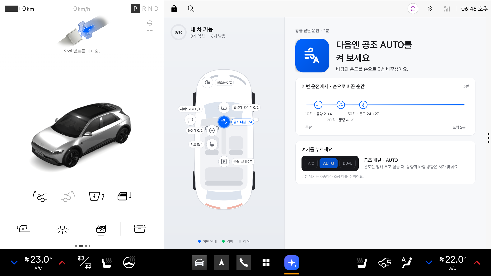

# 안 써본 기능

운전을 마치고 P에 놓으면, 이번 운전에서 쓸 기회가 있었는데 쓰지 않은 차 기능 **하나**를 음성과 화면으로 알려 주는 Pleos Connect 앱입니다. 화면은 왜 권하는지(이번 운전의 근거 타임라인)와 어디를 누르는지(버튼 그림)를 보여 주고, 위에서 본 차 지도에 기능별 익힘 진행을 표시합니다. 그 기능을 나중에 실제로 쓰면 차 신호로 확인해 "써 보셨네요"를 띄우고 다시 알리지 않습니다. 지난 안내는 지도 위 "추천 기록" 버튼으로 날짜별로 다시 볼 수 있고, 항목을 누르면 그때의 안내 화면(근거와 누를 곳)이 그대로 나옵니다.



처음 쓰는 분은 [사용설명서](사용설명서.md)를 먼저 보세요. 이 README는 빌드·시연·설계 문서를 다룹니다.

## 다루는 기능 18개

| 구역 | 기능 |
|---|---|
| 공조 패널 | 공조 AUTO, 동승석 개별 온도, MAX A/C, 오토 내/외기, 뒷유리 열선 |
| 앞유리·와이퍼 | 오토 와이퍼, 앞유리 김서림 제거 |
| 전조등 | 오토 라이트, 하이빔 보조 |
| 사이드미러 | 사이드미러 열선 |
| 운전대 | 운전대 열선, 크루즈 컨트롤 |
| 시트 | 시트 열선, 통풍 시트, 동승석 시트 열선·통풍, 뒷좌석 시트 열선 |
| 콘솔·실내 | 주행 모드, 앰비언트 라이트 |

언제 권하고 무엇을 "썼다"로 보는지는 `specs/002-redesign-21-features/data-model.md`. 그 차에 없다고 확인된 기능(능력 확인 실패, 스위치에 AUTO 없음 등)은 권하지 않고 진행 원 분모에서도 뺍니다.

## 문서

- 설계와 결정 기록: `docs/superpowers/specs/2026-11-08-redesign-21-features-design.md` (1차: `2026-11-08-unused-feature-design.md`)
- 시안: `docs/design/mockup-layout.png`, `docs/design/mockup-states.png`
- 명세·계획·작업·검증:
  - `specs/002-redesign-21-features/`: 2차. `verification.md`에 에뮬레이터 결과와 리뷰 반영이 있다
  - `specs/003-recommendation-history/`: 추천 기록 페이지
  - `specs/001-unused-feature-coach/`: 1차
- 화면 캡처: `docs/screenshots/`
  - 01~09: 첫 실행, 주행 중, 안내, 확인, 권할 것 없음, 도감 완성, 구역 카드, 다크, 세로
  - 10~11: 추천 기록 목록, 다시 보기

## 빌드

```bash
export JAVA_HOME=$(/usr/libexec/java_home -v 17 2>/dev/null || echo /opt/homebrew/opt/openjdk@17/libexec/openjdk.jdk/Contents/Home)
export ANDROID_HOME=$HOME/Library/Android/sdk
./gradlew :app:testDebugUnitTest :app:assembleDebug
```

## 에뮬레이터에서 시연

디버그 빌드는 앱 시계가 **10배 빠릅니다**(1분 → 6초, 5분 → 30초). 출시 빌드는 실제 시간을 씁니다.

```bash
emulator -avd pleos -no-snapshot &      # Cold boot. Quick boot면 VHAL을 못 씀
adb install -r -g app/build/outputs/apk/debug/app-debug.apk
adb shell am start --user 10 -n kr.skku.unusedfeature/.MainActivity
adb forward tcp:8088 tcp:8088           # Virtual Console
scripts/demo.sh reset                   # 차 상태와 앱 기록을 처음으로 (시연 전에 한 번)
scripts/demo.sh climate                 # 풍량·온도를 손으로 → P → 공조 AUTO
scripts/demo.sh learn                   # AUTO를 켠 운전 → P → "공조 AUTO, 써 보셨네요!"
scripts/demo.sh wiper                   # 와이퍼 단계를 손으로 → 오토 와이퍼
scripts/demo.sh rain                    # 비 + 내기 순환 5분 → 앞유리 김서림 제거 (다시: 뒷유리 열선)
scripts/demo.sh highbeam                # 하이빔을 손으로 켜고 끔 → 하이빔 보조 (이 에뮬레이터엔 없어 "권할 것 없음")
scripts/demo.sh night                   # 전조등 켜고 10분 → 앰비언트 라이트
scripts/demo.sh highway                 # 시속 120km로 10분 → 크루즈 컨트롤
scripts/demo.sh heat                    # 난방 27° → 시트 열선
scripts/demo.sh multi                   # 여러 번 하면 하나씩: 운전대 열선 → 동승석 개별 온도 → …
```

스크립트는 단계마다 화면 어디를 보면 되는지 출력합니다. 기어를 D에 두면 Pleos가 "주행 중에는 사용할 수 없습니다"로 앱을 가리고(앱은 주행 중 사용 앱이 아님), P에 놓는 순간 안내가 나옵니다. 브라우저로 `127.0.0.1:8088`을 열어 직접 조작해도 됩니다. 다만 그 페이지를 열어 둔 채 스크립트를 돌리면, 스크립트가 연결할 때 페이지의 토글 상태(예: 앞·뒤 제상 켬)가 다시 들어가 앱이 그 기능을 바로 "익힘"으로 기록합니다. 스크립트로 시연할 때는 페이지를 닫으세요.

**콘솔 페이지로 직접 조작하기**
- 페이지 구성:
  - **기어**: 도로 화면 오른쪽 아래, 속도계 밑의 `P R N D`
  - **페달**: 왼쪽 아래 `ACCEL`, `BRAKE`
  - **SYSTEMS**: `FRONT WIPER`(Off·Auto·Low·High)
  - **CLIMATE**: `Auto`, `Front`·`Rear`(제상), 온도 `−` `+`, 시트 `V3~H3`(V 통풍, H 열선), `FAN SPEED`
  - **Emulation Controls**: 도로 화면 왼쪽 아래 카드. 하이빔, 착좌, 주행거리처럼 버튼이 없는 신호를 검색해 바꾼다.
- 예: `D` → 운전석 온도 `+` 세 번 → 6초 이상 → `P` → 앱에 "공조 AUTO" 안내 → 지도 위 "추천 기록"
- 에뮬레이터 아래 공조 막대(온도 화살표 등)는 앱에 반영되지 않는다.
- 페이지를 새로 열 때도 페이지가 전에 켜 둔 상태가 차에 다시 들어갈 수 있다. 앱이 엉뚱한 기능을 "익힘"으로 기록하면 `scripts/demo.sh reset`을 실행한다.

## 한계

- 오토 홀드, 차로 유지 보조(LFA), i-PEDAL은 다루지 않습니다. 사용 여부를 알 수 있는 계기판 표시등을 읽으려면 외부 앱이 받을 수 없는 내부 전용 권한(`PRIVATE_CAR_SAFETY`)이 필요합니다.
- 차속 신호가 SDK에 없어 고속 구간은 주행거리 변화로 추정합니다(1분 평균 시속 70km 이상). 주행거리 신호가 없는 차는 크루즈를 "20분 이상 운전"으로 판단합니다.
- 에뮬레이터에는 MAX A/C·주행 모드가 없고, 전조등·하이빔 스위치에 AUTO가 없어 오토 라이트·하이빔 보조도 빠집니다(진행 원 0/14). 콘솔로 "사용"까지 만들 수 있는 기능은 10개입니다(`verification.md`).
- 기어가 P가 아니면(D·N) Pleos가 앱을 가리고, R에서는 후방 카메라가 덮습니다. 그래서 "운전 중이에요" 화면은 에뮬레이터에서 눈으로 볼 수 없습니다.
- 버튼 위치 그림은 일반적인 배치입니다. 차종마다 다를 수 있다는 각주를 붙였습니다.
- 시트 메모리는 사용 신호가 없어 다루지 않습니다. 운전자 구분 없이 한 사람으로 봅니다.
- 상시 포그라운드 서비스(`specialUse`)가 Pleos App Market 심사에서 허용되는지 확인하지 못했습니다.
