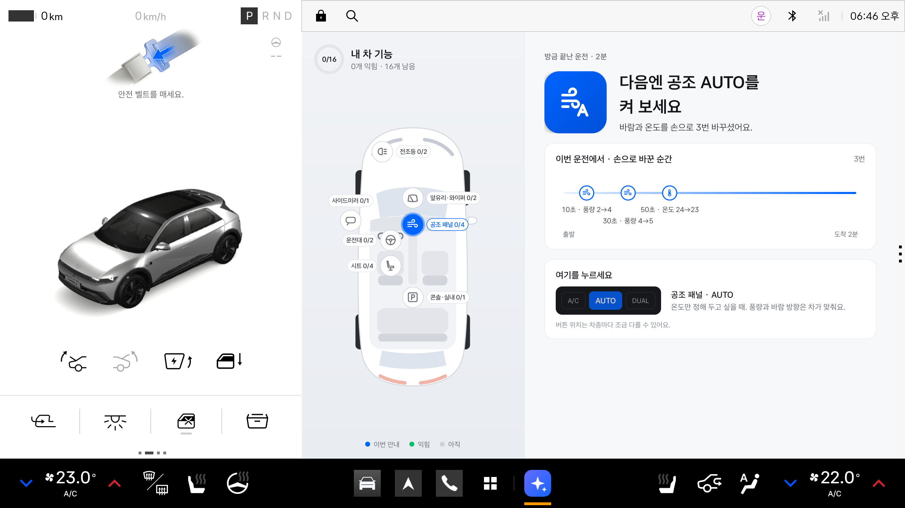
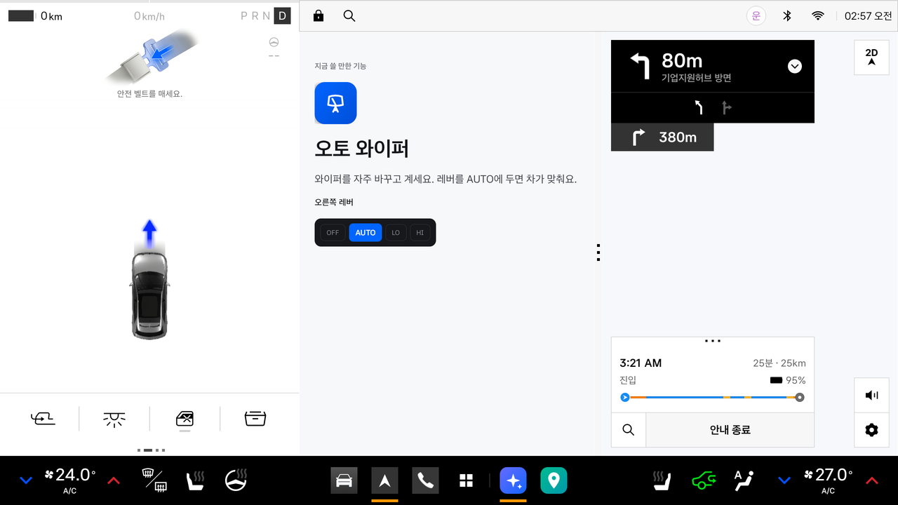
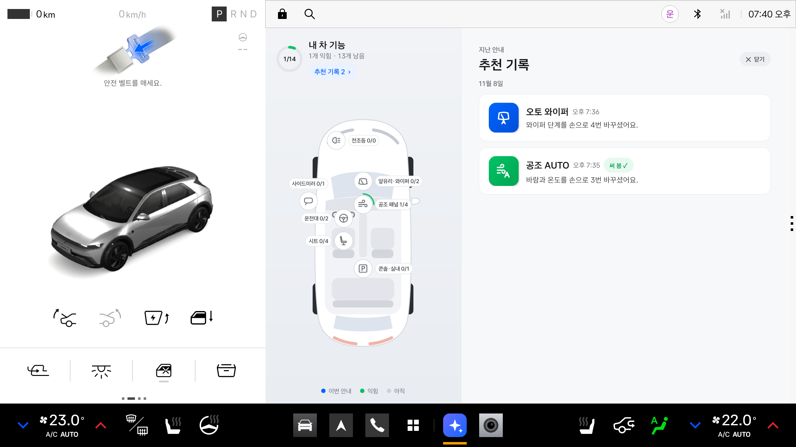
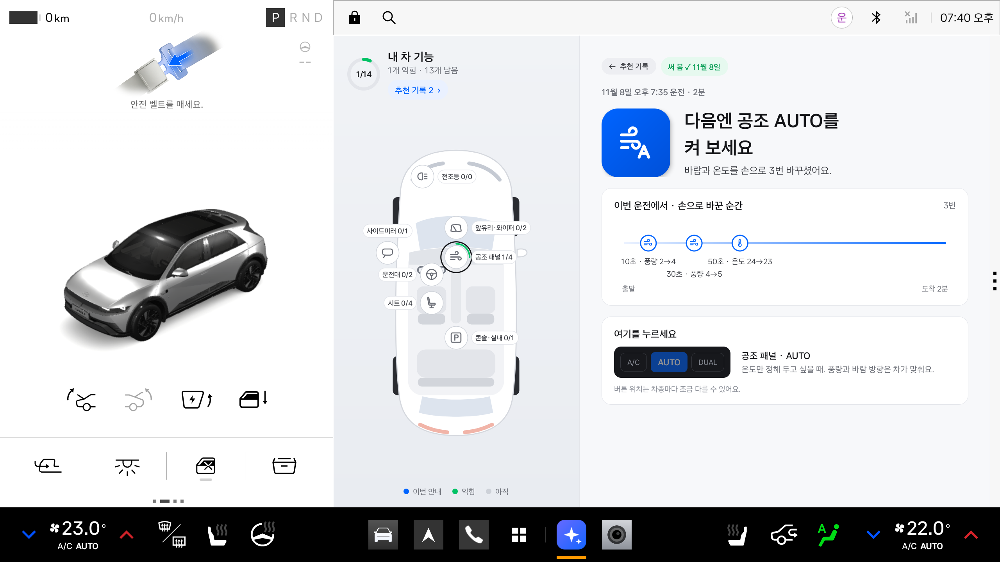

# 안 써본 기능

운전을 마치고 P에 놓으면, 이번 운전에서 쓸 기회가 있었는데 쓰지 않은 차 기능 **하나**를 음성과 화면으로 알려 주는 Pleos Connect 앱입니다.



| 제출 항목 | 내용 |
|---|---|
| 앱 이름과 한 줄 소개 | **안 써본 기능** · 이번 운전에서 쓸 기회가 있었는데 쓰지 않은 차 기능 하나를, 정차하면 근거와 누를 곳과 함께 알려 줍니다 |
| 실행 방법 | [2. 실행 방법](#2-실행-방법) |
| 테스트 환경과 필요한 설정 | [3. 테스트 환경과 필요한 설정](#3-테스트-환경과-필요한-설정) |
| 개발에 사용한 에뮬레이터 버전과 화면 규격 | Pleos Connect v2.1.0(Android 14, API 34) · 가로 2560×1440, 160dpi |
| APK 파일 위치 | [`apk/김김서김김_안써본기능_release.apk`](apk/김김서김김_안써본기능_release.apk) |

처음 쓰는 분은 [사용설명서](사용설명서.md)를 먼저 보세요.

## 1. 앱 이름과 한 줄 소개

- **앱 이름**: 안 써본 기능
- **한 줄 소개**: 이번 운전에서 쓸 기회가 있었는데 쓰지 않은 차 기능 하나를, 정차(P)하면 근거와 누를 곳과 함께 알려 주는 Pleos Connect 앱입니다.

차에는 버튼이 많지만 늘 쓰는 몇 개만 쓰게 됩니다. 앱은 운전하는 동안 차 신호를 보고 있다가, P에 놓는 순간 이번 운전에서 쓸 만했던 기능 하나를 고릅니다. 화면에는 왜 권하는지(이번 운전의 근거 타임라인)와 어디를 누르는지(버튼 그림)가 나오고, 위에서 본 차 지도에 기능별 익힘 진행이 표시됩니다. 그 기능을 나중에 실제로 쓰면 차 신호로 확인해 "써 보셨네요"를 띄우고 다시 알리지 않습니다.

| 기능 | 하는 일 |
|---|---|
| 운전 직후 안내 | P에 놓으면 기능 하나를 고르고 한 번 말합니다. 화면에는 이유, 근거 타임라인, 누를 곳 그림이 나옵니다. 예: 바람·온도를 손으로 여러 번 바꿈 → 공조 AUTO, 비가 오는 동안 내기 순환 5분 → 앞유리 김서림 제거 |
| 써 보셨네요 | 권한 기능을 다음 운전에서 켜면 차 신호로 확인해 익힘으로 기록합니다. 익힌 기능은 다시 권하지 않습니다 |
| 주행 중 한마디 | 운전 중에 기회가 생긴 순간(예: 와이퍼를 손으로 세 번 바꿈) 손 닿는 기능 하나를 짧은 문구로 한 번 말하고, 내비 옆 칸 카드에 기능 이름·문구·누를 곳을 보입니다. 한 운전에 두 번까지, 5분 간격이고, 방향지시등을 켠 동안은 미룹니다. 권한 기능을 켜면 카드가 초록 체크와 "써 봤어요"로 바뀝니다 |
| 주행 최적화 | 앱이 주행 최적화(DO)를 선언해 D에서도 가려지지 않습니다. 주행 중 화면은 움직이지 않고 누를 것이 없습니다. 이번 운전 중에 이미 권한 기능이면 P에서는 화면만 보이고 다시 말하지 않습니다 |
| 음성 자막 | 큰 제목 아래에 "방금 들은 음성"과 앱이 말한 문장이 스피커 아이콘과 함께 남습니다. 말하기 시작한 때부터 6초 동안 소리 막대 셋이 움직입니다 |
| 새 안내 강조 | P에 놓은 지 10초 동안 차 지도의 추천 구역에 넓은 링이 퍼지고 이름표가 굵어집니다. 움직임 줄이기 설정이면 굵은 테두리만 보입니다 |
| 추천 기록 | 지도 위 "추천 기록"에서 지난 안내를 날짜별로 봅니다. 카드마다 작은 차 그림과 그 기능 구역 점이 있고(익힘 초록, 아직 파랑, 이 차에 없음 회색), 누르면 그때의 안내 화면(근거, 누를 곳, 그때 들은 음성)이 그대로 나옵니다 |

| 주행 중 한마디(내비 옆 칸) | 추천 기록 | 다시 보기 |
|---|---|---|
|  |  |  |

### 다루는 기능 18개

| 구역 | 기능 |
|---|---|
| 공조 패널 | 공조 AUTO, 동승석 개별 온도, MAX A/C, 오토 내/외기, 뒷유리 열선 |
| 앞유리·와이퍼 | 오토 와이퍼, 앞유리 김서림 제거 |
| 전조등 | 오토 라이트, 하이빔 보조 |
| 사이드미러 | 사이드미러 열선 |
| 운전대 | 운전대 열선, 크루즈 컨트롤 |
| 시트 | 시트 열선, 통풍 시트, 동승석 시트 열선·통풍, 뒷좌석 시트 열선 |
| 콘솔·실내 | 주행 모드, 앰비언트 라이트 |

언제 권하고 무엇을 "썼다"로 보는지는 `specs/002-redesign-21-features/data-model.md`에 있습니다. 그 차에 없다고 확인된 기능(능력 확인 실패, 스위치에 AUTO 없음 등)은 권하지 않고 진행 원 분모에서도 뺍니다. 앰비언트 라이트와 뒷좌석 시트 열선은 주행 중에 권하지 않습니다(화면 메뉴이거나 운전자 손이 닿지 않음).

## 2. 실행 방법

앱은 차 신호가 바뀌어야 움직입니다. 에뮬레이터에서는 Virtual Console(콘솔 페이지 `127.0.0.1:8088`)로 기어, 공조, 와이퍼 같은 신호를 넣습니다. release APK를 깔고 콘솔 페이지로 직접 운전해 볼 수 있고(2-2), 시연 스크립트로 정해 둔 장면을 그대로 재현할 수도 있습니다(2-3).

### 2-1. 에뮬레이터 준비

Pleos Connect 에뮬레이터는 [공식 안내](https://document.pleos.ai/docs/connect/guide/getting-started/application-development/setup-connect-sdk-emulator)대로 설치합니다.

```bash
emulator -avd pleos -no-snapshot &      # Cold boot. Quick boot면 차 신호(VHAL)를 못 씁니다. pleos 자리에 만든 AVD 이름
adb forward tcp:8088 tcp:8088           # Virtual Console. 부팅마다 한 번
```

### 2-2. release APK로 직접 써 보기

```bash
adb uninstall kr.skku.unusedfeature     # 디버그 빌드를 깐 적이 있을 때만(서명이 달라 덮어쓸 수 없습니다)
adb install -r -g apk/김김서김김_안써본기능_release.apk
adb shell am start --user 10 -n kr.skku.unusedfeature/.MainActivity   # 앱 목록에서 눌러도 됩니다
```

브라우저로 `127.0.0.1:8088` 콘솔 페이지를 열고 운전합니다.

- 예: `D` → 운전석 온도를 `+`로 27°까지 올림 → 1분 넘게 기다림 → `P` → 앱에 "시트 열선" 안내("난방을 27°로 트셨어요", 들은 음성 자막, 누를 곳 그림) → 지도 위 "추천 기록"
- release 빌드는 실제 시간을 씁니다. 1분보다 짧은 운전은 안내하지 않습니다.
- 페이지 구성
  - **기어**: 도로 화면 오른쪽 아래, 속도계 밑의 `P R N D`
  - **페달**: 왼쪽 아래 `ACCEL`, `BRAKE`
  - **SYSTEMS**: `FRONT WIPER`(Off·Auto·Low·High)
  - **CLIMATE**: `Auto`, `Front`·`Rear`(제상), 온도 `−` `+`, 시트 `V3~H3`(V 통풍, H 열선), `FAN SPEED`
  - **Emulation Controls**: 도로 화면 왼쪽 아래 카드. 하이빔, 착좌, 주행거리처럼 버튼이 없는 신호를 검색해 바꿉니다.
- 에뮬레이터 아래 공조 막대(온도 화살표 등)는 앱에 반영되지 않습니다.
- 콘솔 페이지를 새로 열면 전에 켜 둔 상태가 차에 다시 들어갈 수 있습니다. 그러면 앱이 그 기능을 바로 "익힘"으로 기록합니다.

### 2-3. 시연 스크립트로 장면 재현(디버그 빌드)

시연 스크립트는 디버그 빌드에서 돕니다. 디버그 빌드는 앱 시계가 **10배 빠르고**(실제 6초 = 앱의 1분), 시연 준비용 수신기 두 개(`SeedReceiver`, `MirrorReceiver`)가 들어 있습니다. 두 수신기는 DUMP 권한이 걸려 adb shell만 부를 수 있고, release 빌드에는 없습니다.

```bash
export JAVA_HOME=$(/usr/libexec/java_home -v 17 2>/dev/null || echo /opt/homebrew/opt/openjdk@17/libexec/openjdk.jdk/Contents/Home)
export ANDROID_HOME=$HOME/Library/Android/sdk
./gradlew :app:testDebugUnitTest :app:assembleDebug
adb uninstall kr.skku.unusedfeature     # release를 깐 적이 있을 때만
adb install -r -g app/build/outputs/apk/debug/app-debug.apk
adb shell am start --user 10 -n kr.skku.unusedfeature/.MainActivity

scripts/demo.sh reset      # 차 상태와 앱 기록을 처음으로(시연 전에 한 번)
scripts/demo.sh climate    # 풍량·온도를 손으로 → P → 공조 AUTO
scripts/demo.sh learn      # AUTO를 켠 운전 → P → "공조 AUTO, 써 보셨네요!"
scripts/demo.sh wiper      # 와이퍼 단계를 손으로 → 오토 와이퍼
scripts/demo.sh rain       # 비 + 내기 순환 5분 → 앞유리 김서림 제거(다시 하면 뒷유리 열선)
scripts/demo.sh highbeam   # 하이빔을 손으로 켜고 끔 → 하이빔 보조(이 에뮬레이터엔 없어 "권할 것 없음")
scripts/demo.sh night      # 전조등 켜고 10분 → 앰비언트 라이트
scripts/demo.sh highway    # 시속 120km로 10분 → 크루즈 컨트롤
scripts/demo.sh heat       # 난방 27° → 시트 열선
scripts/demo.sh multi      # 여러 번 하면 하나씩: 운전대 열선 → 동승석 개별 온도 → …
scripts/demo.sh seed       # 추천 기록 6개·익힘 2개인 시연 상태 → 앰비언트 라이트 안내
scripts/demo.sh live       # 화면을 1:1로 나눈 내비 옆 칸, 주행 중 권함 두 번(오토 와이퍼 → 써 봤어요 → 시트 열선) → P
```

- 스크립트는 단계마다 화면 어디를 보면 되는지 출력합니다.
- 스크립트로 시연할 때는 콘솔 페이지를 닫습니다. 열어 둔 채 돌리면 스크립트가 연결할 때 페이지의 토글 상태(예: 앞·뒤 제상 켬)가 다시 들어가, 앱이 그 기능을 바로 "익힘"으로 기록합니다.
- 앱이 엉뚱한 기능을 "익힘"으로 기록하면 `scripts/demo.sh reset`을 다시 합니다.

## 3. 테스트 환경과 필요한 설정

| 항목 | 값 |
|---|---|
| 개발 컴퓨터 | macOS 26(Apple Silicon) |
| 빌드 도구 | JDK 17, Gradle 8.11.1(래퍼 포함), Android Gradle Plugin 8.8.2, Kotlin 2.0.21 |
| Android SDK | compileSdk 35, targetSdk 34, minSdk 28 |
| Pleos SDK | Vehicle 2.3.2, TextToSpeech 3.3.1(온디바이스) |
| 권한 | 차 조회 권한 `CAR_INFO`·`CAR_DRIVE`·`CAR_CLIMATE`·`CAR_SEATS`·`CAR_LIGHTS`·`CAR_WINDOWS`·`CAR_MIRRORS`, `TTS_SERVICE`, 포그라운드 서비스(`specialUse`), 부팅 완료 수신, 알림. 제어 권한은 쓰지 않습니다(디버그 빌드의 `MirrorReceiver`만 사이드미러 열선을 켰다 끕니다) |
| 시연 스크립트 | `sh`, `curl`, adb |

**필요한 설정**

- **Pleos SDK 저장소**: Pleos Playground Maven(`https://nexus-playground.pleos.ai/repository/maven-releases/`)이 `settings.gradle.kts`에 들어 있습니다. 처음 빌드할 때 인터넷 연결이 필요하고, 따로 넣을 키는 없습니다.
- **Android SDK 위치**: `ANDROID_HOME`을 지정하거나, Android Studio로 열어 `local.properties`를 만듭니다(저장소에는 없습니다). 스크립트는 `$ANDROID_HOME/platform-tools/adb`를 씁니다.
- **Cold boot와 콘솔 연결**: 에뮬레이터는 `-no-snapshot`으로 켜고, 부팅마다 `adb forward tcp:8088 tcp:8088`을 합니다. 안 하면 스크립트의 쓰기가 조용히 실패합니다.
- **시연 전 reset**: 콜드 부팅 직후 콘솔은 한 번도 바꾸지 않은 값을 차에 보내지 않습니다. 그러면 앱은 그 기능을 신호 없는 기능으로 보고 안내 후보에서 뺍니다(앱 시작 로그 `CarWatcher: 신호 받은 기능`). `scripts/demo.sh reset`이 시트 열선·운전대 열선·DUAL은 콘솔로, 콘솔에 없는 사이드미러 열선은 `MirrorReceiver`로 한 번 켰다 꺼서 넷 모두 들어오게 합니다. 오토 내/외기도 콘솔에 조작이 없어 부팅에 따라 들어오지 않을 수 있습니다(시연 장면은 이 기능에 기대지 않습니다).
- **내비 옆 칸**: 화면 오른쪽 끝 창 손잡이(⋮)를 가운데로 끌면 1:1로 나뉩니다(`adb shell input swipe 2547 720 1500 720 800`, `demo.sh live`가 대신 합니다). 이 에뮬레이터는 1:1만 됩니다. 풀 때는 손잡이를 오른쪽 끝으로 끕니다(`adb shell input swipe 1706 720 2550 720 800`).
- **단위 테스트**: `./gradlew :app:testDebugUnitTest`

## 4. 개발에 사용한 Pleos Connect 에뮬레이터 버전과 화면 규격

| 항목 | 값 |
|---|---|
| 에뮬레이터 | **Pleos Connect v2.1.0**(시스템 이미지 `pleos_car_emulator`, 빌드 `release_connect_v2.1.0`) |
| Android | 14(API 34), user 빌드, arm64-v8a |
| 화면 규격 | **가로 2560×1440, 160dpi**(1dp = 1px) |
| 앱 창 | 1682×1210dp(가로 기본 창). 내비 옆 1:1 화면 나누기 칸(세로로 좁은 칸)에서도 확인했습니다 |
| 테마 | 낮·밤(다크) 모두 확인했습니다 |
| 그 밖의 AVD 설정 | Android Emulator 37.2.13.0, 메모리 8GB, GPU host |

## 5. APK 파일 위치

| 빌드 | 위치 | 쓰임 |
|---|---|---|
| release | [`apk/김김서김김_안써본기능_release.apk`](apk/김김서김김_안써본기능_release.apk) | 설치해서 직접 써 보기(2-2). 실제 시간을 씁니다 |
| debug | `app/build/outputs/apk/debug/app-debug.apk`(빌드하면 생기고, 저장소에는 없습니다) | 시연 스크립트(2-3) |

- release APK는 팀 서명 키(저장소 밖에 보관)로 서명했습니다. 소스에서 `./gradlew :app:assembleRelease`로 만들면 서명 안 된 APK가 나오므로, 직접 만든 release를 설치하려면 각자 키로 서명(`apksigner sign`)해야 합니다.

## 한계

- 오토 홀드, 차로 유지 보조(LFA), i-PEDAL은 다루지 않습니다. 사용 여부를 알 수 있는 계기판 표시등을 읽으려면 외부 앱이 받을 수 없는 내부 전용 권한(`PRIVATE_CAR_SAFETY`)이 필요합니다.
- 차속 신호가 SDK에 없어 고속 구간은 주행거리 변화로 추정합니다(1분 평균 시속 70km 이상). 주행거리 신호가 없는 차는 크루즈를 "20분 이상 운전"으로 판단합니다.
- 에뮬레이터에는 MAX A/C·주행 모드가 없고, 전조등·하이빔 스위치에 AUTO가 없어 오토 라이트·하이빔 보조도 빠집니다(진행 원 0/14). 콘솔로 "사용"까지 만들 수 있는 기능은 10개입니다(`specs/002-redesign-21-features/verification.md`).
- R에서는 후방 카메라가 앱을 덮습니다.
- 버튼 위치 그림은 일반적인 배치입니다. 차종마다 다를 수 있다는 각주를 붙였습니다.
- 시트 메모리는 사용 신호가 없어 다루지 않습니다. 운전자 구분 없이 한 사람으로 봅니다.
- 상시 포그라운드 서비스(`specialUse`)가 Pleos App Market 심사에서 허용되는지 확인하지 못했습니다.
- 자막은 앱이 말하려고 만든 문장입니다. 음성이 실제로 스피커에서 났는지는 알 수 없고, 막대는 음성 엔진에 말하라고 넘긴 때부터 6초를 셉니다.
- `seed` 샘플의 기록·이유·근거는 시연 준비값입니다(이유 문장은 앱의 문장 함수로 만든 값). 디버그 빌드에만 있고 adb shell로만 부를 수 있습니다.

## 설계 문서

- 설계 초안과 결정 기록: `docs/superpowers/specs/`, 시안: `docs/design/`
- 명세·계획·작업·검증: `specs/`(폴더마다 `spec.md`, `plan.md`, `tasks.md`, 에뮬레이터 결과 `verification.md`)
  - `001-unused-feature-coach/`: 첫 판(기능 6개)
  - `002-redesign-21-features/`: 화면 재설계와 기능 18개. `verification.md`에 에뮬레이터에서 확인한 플랫폼 사실이 있습니다
  - `003-recommendation-history/`: 추천 기록
  - `004-visible-tips/`: 음성 자막, 기록 카드 지도, 새 안내 강조, 시연 샘플
  - `005-live-tips/`: 주행 중 한마디(주행 최적화)
  - `006-car-screen/`: 차 화면 기준(글자 24sp, 누르는 칸 76dp, 대비 4.5:1)에 맞춘 개선
  - `007-demo-pictures/`: 시연 샘플의 그림과 문장 맞추기
- 화면 캡처: `docs/screenshots/`
