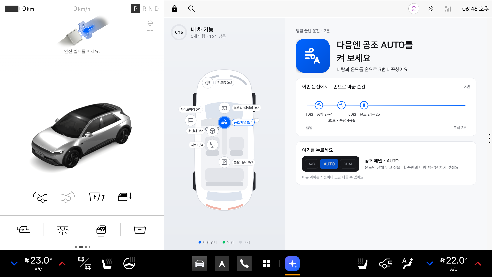
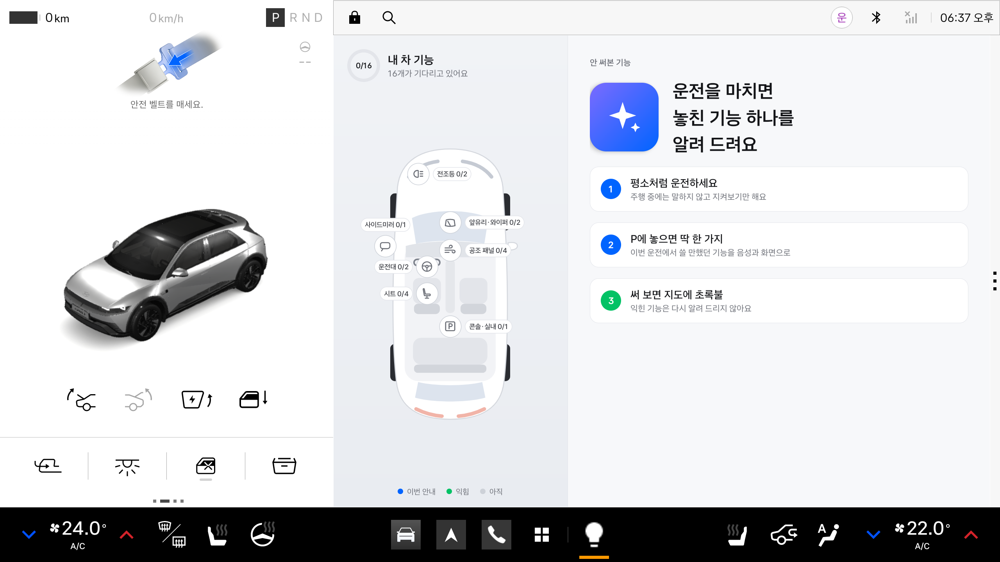
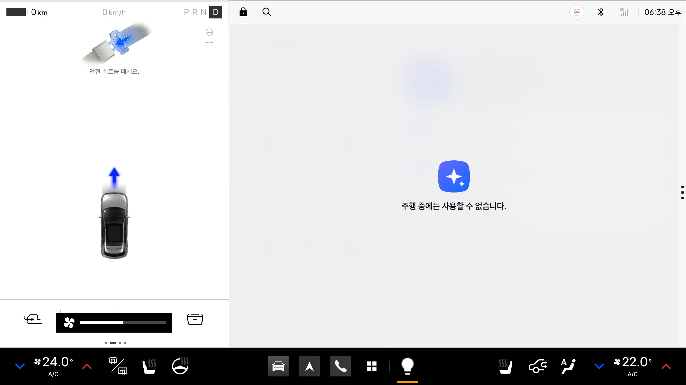
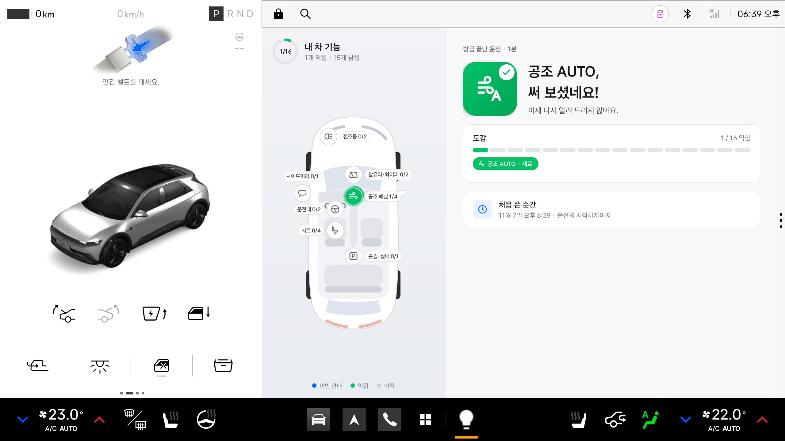
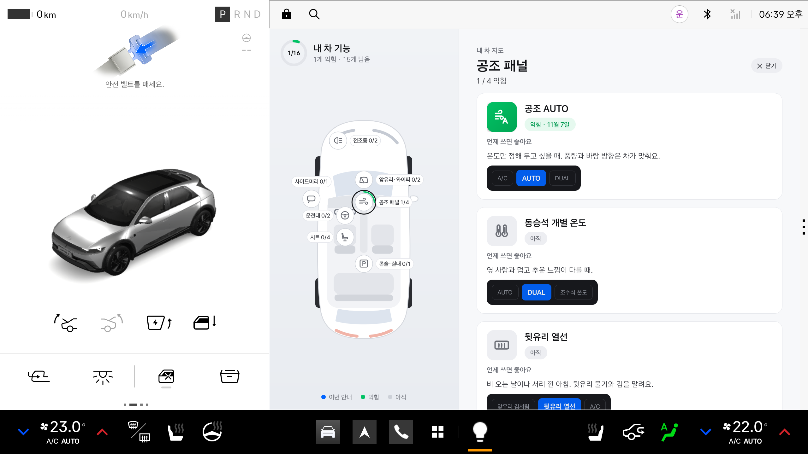
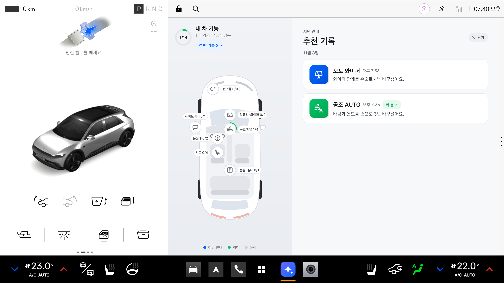
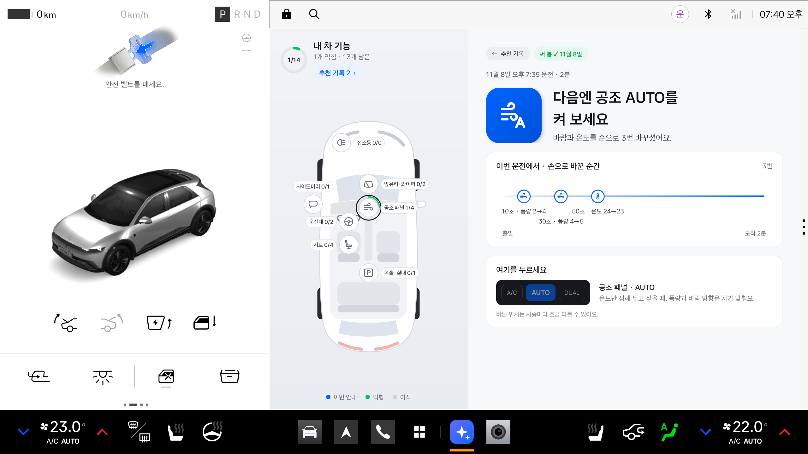

# 안 써본 기능 — 사용설명서

> 운전을 마치고 P에 놓으면, 이번 운전에서 쓸 만했던 차 기능 **하나**를 알려 드리는 Pleos Connect 앱이에요.



## 이런 분께 맞아요

- 차에 버튼은 많은데 늘 쓰는 몇 개만 쓰는 분
- 새 차를 받았지만 어떤 기능이 있는지 다 모르는 분
- 두꺼운 차량 설명서를 펼쳐 볼 시간이 없는 분

앱은 기능을 한꺼번에 소개하지 않아요. **이번 운전에서 실제로 쓸 기회가 있었던 기능 하나**만, 왜 권하는지와 어디를 누르면 되는지를 함께 알려 드려요.

## 세 단계로 동작해요

1. **평소처럼 운전하세요.** 주행 중에는 말하지도 화면을 바꾸지도 않아요. 차 신호만 조용히 지켜봐요.
2. **P에 놓으면 딱 한 가지.** 이번 운전에서 쓸 만했던 기능 하나를 음성과 화면으로 알려 드려요.
3. **써 보면 초록불.** 다음에 그 기능을 쓰면 차 신호로 알아채고 "써 보셨네요"라고 알려 드려요. 익힌 기능은 다시 권하지 않아요.

## 설치하고 처음 열기

**필요한 것**: Pleos Connect가 들어간 차, 또는 Pleos Connect Emulator v2.1.0(Android API 34)

1. **설치**: 아직 Pleos App Market에는 없어서 APK 파일을 직접 설치해요. 컴퓨터에 차(또는 에뮬레이터)를 연결하고 아래를 실행하세요.

   ```bash
   adb install -r -g 앱파일.apk
   ```

   APK를 직접 만들려면 [README의 "빌드"](README.md#빌드)를 따르세요.
2. **열기**: 앱 목록에서 **안 써본 기능**을 누르세요. 에뮬레이터에서는 명령으로도 열 수 있어요.

   ```bash
   adb shell am start --user 10 -n kr.skku.unusedfeature/.MainActivity
   ```

3. **알림 허용**: 처음 열 때 알림 권한을 물어요. 허용하면 P에 놓았을 때 안내가 알림으로도 떠요.



한 번 열어 두면 앱 화면을 닫아도 뒤에서 운전을 지켜봐요. 그동안 알림 영역에 "운전을 지켜보는 중"이 보여요. 차를 다시 켜면(부팅) 앱을 열지 않아도 알아서 시작해요.

## 화면 둘러보기

가로 화면은 왼쪽에 **내 차 지도**, 오른쪽에 **지금 상황**이 나와요. 세로 화면에서는 위가 지금 상황, 아래가 지도예요. 차의 라이트·다크 설정을 그대로 따라가요.

### 운전 중

기어가 D·N이면 Pleos가 "주행 중에는 사용할 수 없습니다"로 앱을 가리고, R이면 후방 카메라 화면이 덮어요. 앱 안에서도 "운전 중이에요"만 보여요. 운전에 집중하실 수 있게 일부러 아무것도 바꾸지 않아요.



운전 도중에 앱을 처음 켰다면 그 운전은 기록하지 않아요("이번 운전은 기록하지 않아요. 다음 운전부터 지켜볼게요.").

### P에 놓으면: 오늘의 한 가지

- **제목과 이유**: "다음엔 공조 AUTO를 켜 보세요"와 이유 한 줄(예: "바람과 온도를 손으로 4번 바꾸셨어요.")
- **이번 운전에서**: 그런 일이 언제 있었는지 운전 시간 위에 표시한 타임라인
- **여기를 누르세요**: 버튼 줄에서 누를 버튼이 파랗게 깜빡이고, 그 자리와 언제 쓰면 좋은지가 함께 나와요. 버튼 위치는 차종마다 조금 다를 수 있어요.
- **음성과 알림**: 음성으로 한 번 말하고, 알림 "안 써본 기능: 공조 AUTO"가 떠요.
- **들은 음성(자막)**: 큰 제목 아래 카드에 방금 말한 문장이 그대로 남아요. 말하는 동안(처음 6초) 스피커 옆 막대 셋이 움직여서, 소리를 못 들었어도 무엇을 말했는지 알 수 있어요.
- **지도**: 그 기능이 있는 구역 점이 파랗게 깜빡여요. P에 놓은 뒤 10초 동안은 넓은 링이 퍼지고 구역 이름이 굵어져서 어디인지 먼저 눈에 들어와요(기기의 움직임 줄이기 설정이면 굵은 테두리만).

### 써 보셨네요

안내받은 기능을 실제로 쓰면(정차 중이어도) 바로 "익힘"으로 저장해요. 다음에 P에 놓으면 "써 보셨네요!" 화면과 도감 진행이 나와요. 새 안내가 있으면 그 위에 초록 띠로 함께 알려 드려요.



- **권할 기능이 없을 때**: "이번 운전에선 권할 기능이 없었어요"와 함께, 이번 운전에서 쓴 기능과 아직 남은 기능이 보여요.
- **도감 완성**: 이 차가 지원하는 기능을 모두 익히면 도감 완성 화면이 나와요.

### 내 차 지도

위에서 본 차 그림 위에 구역 점 7개가 있어요.

| 구역 | 구역 | 구역 |
|---|---|---|
| 공조 패널 | 앞유리·와이퍼 | 전조등 |
| 사이드미러 | 운전대 | 시트 |
| 콘솔·실내 | | |

- 점을 누르면 그 구역의 기능마다 상태(익힘 · 안내함 n회 · 아직 · 이 차에 없음), 언제 쓰면 좋은지, 누를 곳이 나와요.
- 가운데 원은 익힌 기능 수 / 이 차가 지원하는 기능 수예요.



### 추천 기록

지도 위 **추천 기록** 버튼을 누르면 지난 안내가 날짜별로(최신이 위) 나와요. 카드 오른쪽 작은 차 그림의 점이 그 기능 자리예요(써 봄 초록, 아직 파랑, 이 차에 없음 회색). 항목을 누르면 그때 안내 화면(근거와 누를 곳, "그때 들은 음성")을 그대로 다시 볼 수 있어요. "←  추천 기록"으로 목록에 돌아가고, "✕  닫기"로 닫아요. 운전 중에는 열리지 않아요.

| 목록 | 다시 보기 |
|---|---|
|  |  |

## 알려 드리는 기능 18가지

| 구역 | 기능 | 이럴 때 알려 드려요 | 누를 곳 |
|---|---|---|---|
| 공조 패널 | 공조 AUTO | 바람과 온도를 손으로 3번 이상 바꿨을 때 | 공조 패널 AUTO |
| 공조 패널 | 동승석 개별 온도 | 옆자리에 사람이 있고 온도를 바꿨을 때 | 공조 패널 DUAL |
| 공조 패널 | MAX A/C | 에어컨을 17° 이하로 틀었을 때 | 공조 패널 MAX A/C |
| 공조 패널 | 오토 내/외기 | 내기·외기를 손으로 2번 이상 바꿨을 때 | 공조 패널 오토 내/외기 |
| 공조 패널 | 뒷유리 열선 | 와이퍼가 5분 이상 움직였을 때(비) | 공조 패널 뒷유리 열선 |
| 앞유리·와이퍼 | 오토 와이퍼 | 와이퍼 단계를 손으로 3번 이상 바꿨을 때 | 오른쪽 레버 AUTO |
| 앞유리·와이퍼 | 앞유리 김서림 제거 | 비 오는 동안 내기 순환을 5분 이상 켜 뒀을 때 | 공조 패널 앞유리 김서림 |
| 전조등 | 오토 라이트 | 전조등을 손으로 2번 이상 켜고 껐을 때 | 왼쪽 레버 AUTO |
| 전조등 | 하이빔 보조 | 하이빔을 손으로 3번 이상 켜고 껐을 때 | 왼쪽 레버를 앞으로 밀기 |
| 사이드미러 | 사이드미러 열선 | 와이퍼가 5분 이상 움직였을 때(비) | 공조 패널 미러 열선 |
| 운전대 | 운전대 열선 | 시트 열선을 켰을 때 | 공조 패널 운전대 열선 |
| 운전대 | 크루즈 컨트롤 | 시속 70km 이상으로 10분 이상 달렸을 때 | 운전대 오른쪽 CRUISE |
| 시트 | 시트 열선 | 난방을 26° 이상으로 틀고 시트 열선은 켜지 않았을 때 | 공조 패널 시트 열선 |
| 시트 | 통풍 시트 | 에어컨을 21° 이하로 틀고 시트 열선은 켜지 않았을 때 | 공조 패널 통풍 |
| 시트 | 동승석 시트 열선·통풍 | 옆자리에 사람이 있는데 운전석 시트 열선·통풍만 켰을 때 | 공조 패널 조수석 쪽 |
| 시트 | 뒷좌석 시트 열선 | 뒷좌석에 사람이 있고 운전석 시트 열선을 켰을 때 | 뒷좌석 공조 |
| 콘솔·실내 | 주행 모드 | 시속 70km 이상으로 15분 이상 달리는 동안 주행 모드를 바꾸지 않았을 때 | 기어 옆 콘솔 ECO |
| 콘솔·실내 | 앰비언트 라이트 | 전조등을 켜고 10분 이상 달렸을 때 | 화면 설정 › 조명 › 앰비언트 |

고르는 규칙은 이래요.

- 한 번에 **하나**만 알려 드려요. 여러 기능이 해당되면 덜 알려 드린 기능부터 골라요.
- 그 운전에서 이미 쓴 기능과 익힌 기능은 권하지 않아요.
- 같은 기능은 **최대 3번**까지만 알려 드려요.
- 이 차에 없는 기능(신호가 오지 않는 기능)은 권하지 않고, 도감 수에서도 빼요.
- 1분이 안 되는 운전은 세지 않아요.

## 자주 묻는 질문

**운전 중에는 왜 아무 말도 안 하나요?**
운전에 집중하실 수 있게 하려고요. 음성과 화면은 P에 놓은 뒤에만 나와요.

**같은 기능을 계속 알려 주나요?**
아니요. 같은 기능은 최대 3번이고, 한 번 써 보시면 더는 권하지 않아요.

**앱을 닫아도 되나요?**
네. 뒤에서 계속 지켜봐요(알림 "운전을 지켜보는 중"). 차를 다시 켜면 알아서 시작해요.

**기록은 어디에 남나요?**
차 안의 앱 저장소에만 남아요. 위치나 경로는 모으지 않고, 밖으로 보내지도 않아요. 앱을 지우면 기록도 함께 지워져요.

**화면 위에 빨간 띠 "차 신호를 받지 못하고 있어요"가 보여요.**
차와 연결되지 않았다는 뜻이에요. 앱이 10초마다 다시 연결해요. 계속 보이면 앱을 다시 열어 보세요.

**누를 곳 그림이 우리 차와 달라요.**
그림은 일반적인 배치예요. 차종마다 조금 다를 수 있어요.

**도감 수가 18이 아니에요.**
이 차에 없는 기능은 빼고 세기 때문이에요. 예를 들어 에뮬레이터는 지원하는 기능이 14개예요.

## 에뮬레이터에서 직접 해 보기

에뮬레이터에서는 Virtual Console 웹 페이지(`127.0.0.1:8088`, `adb forward tcp:8088 tcp:8088` 필요)로 차를 조작해요.

1. 도로 화면 오른쪽 아래 `P R N D`에서 **D**를 누르세요.
2. CLIMATE의 운전석 온도 **+**를 세 번 누르세요.
3. 6초 넘게 기다린 뒤 **P**를 누르세요.
4. "다음엔 공조 AUTO를 켜 보세요" 안내가 나와요. 이어서 AUTO를 켜고 다시 운전하면 "써 보셨네요"가 나와요.

알아 둘 점:
- 시연용(디버그) 빌드는 앱이 재는 시간이 **10배 빨라요**(1분 → 6초, 5분 → 30초). 출시용 빌드는 실제 시간을 써요.
- 콘솔 페이지를 새로 열면 페이지에 남아 있던 상태가 차에 다시 들어가, 앱이 엉뚱한 기능을 "익힘"으로 기록할 수 있어요. 그럴 땐 `scripts/demo.sh reset`으로 처음 상태로 되돌리세요.
- 에뮬레이터를 콜드 부팅한 직후에는 콘솔이 몇몇 값(시트 열선, 운전대 열선, 동승석 개별 온도, 사이드미러 열선, 오토 내/외기)을 차에 보내지 않아, 앱이 그 기능을 "이 차에 없는 기능"으로 볼 수 있어요. 시연 전에 `scripts/demo.sh reset`을 먼저 돌리면 앞의 셋은 들어와요.
- 상황별 시연 스크립트는 [README의 "에뮬레이터에서 시연"](README.md#에뮬레이터에서-시연)에 있어요.

## 알아 두면 좋은 한계

- 오토 홀드, 차로 유지 보조(LFA), i-PEDAL은 다루지 않아요. 외부 앱이 읽을 수 없는 신호라서요.
- 크루즈 컨트롤과 주행 모드의 "빠르게 달린 구간"(1분 평균 시속 70km 이상)은 주행거리 변화로 추정한 속도로 판단해요. 주행거리 신호가 없는 차에서는 크루즈 컨트롤을 "20분 이상 운전"으로 판단해요.
- 운전자를 구분하지 않고 한 사람으로 봐요.
